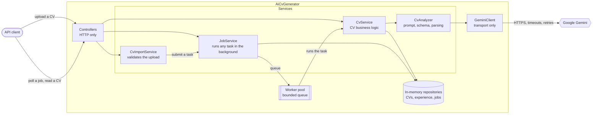

# AiCvGenerator: how the service fits together

A REST service that turns an uploaded CV (`.pdf` or `.docx`) into structured data. Text extraction is local, understanding the text is delegated to Google Gemini, and the slow part runs in the background so uploads return at once.

Diagrams are Mermaid, which GitHub and most IDEs render. Binding rules live in [`ARCHITECTURE.md`](../ARCHITECTURE.md); setup and commands in [`CLAUDE.md`](../CLAUDE.md).

## The idea in one picture

## The parts

| Part | Package | Responsibility |
|---|---|---|
| Controllers | `controller` | Routing, status codes, converting DTOs and ids. No business logic |
| `CvImportService` | `service` | The only place that knows a CV import is a job: checks the file, builds the task |
| `JobService` | `service` | Runs any `JobTask` in the background and records PENDING, PROCESSING, COMPLETED or FAILED. Knows nothing about CVs |
| `CvService` | `service` | Extract text, analyse it, validate, then store the CV (upsert by email) |
| `CvAnalyzer` | `service` | The CV prompt and response schema, and parsing Gemini's answer |
| `GeminiClient` | `client` | Sends a prompt and returns the answer. Timeouts, and retries for 503 and 429 only |
| Repositories | `repository` | In-memory `ArrayList` storage. Atomic upserts, copies on read and write |
| Mappers | `mapper` | MapStruct at every layer boundary. DTO ids are strings |

## Key behaviours

- **Upload is quick.** `POST /api/v1/cvs` checks the file, creates a job and returns `202 Accepted` with a `Location` header. It never waits for Gemini.
- **Clients poll.** `GET /api/v1/jobs/{id}` shows the job. When it is `COMPLETED`, `entityType` and `entityId` point at the CV, which is read with `GET /api/v1/cvs/{id}`.
- **Bounded work.** A fixed pool with a bounded queue. When the queue is full the upload gets `503` and no job remains.
- **Failures are recorded, not thrown.** Whatever goes wrong on a worker ends up on the job as `errorCode` plus a safe message.
- **Same email, same CV.** Importing a CV with an email that is already stored replaces that CV.
- **Memory only.** Everything is lost on restart, and an old job id then returns `404`.

## Sequence diagrams

1. [Upload and background processing](sequence-cv-import.md): the normal path from `POST` to a stored CV.
2. [Failures and the busy server](sequence-failures.md): every way a request or a job can end badly.
