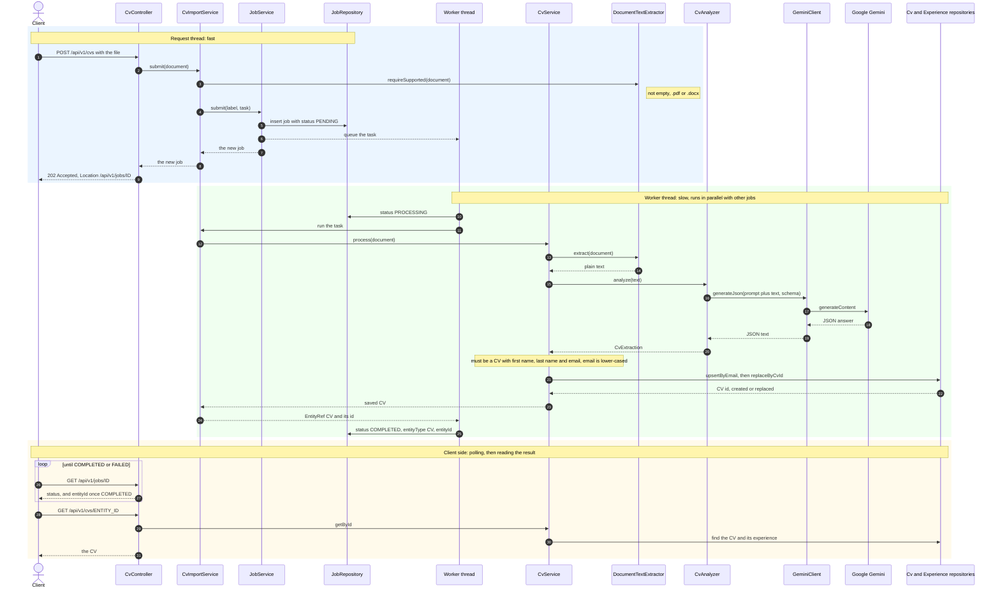

# Sequence: uploading a CV

The normal path, from the upload to reading the stored CV. The request thread only validates and queues; a worker thread does the slow work.

## Things worth knowing

- `JobService` never learns what the task does. `CvImportService` passes it a function and gets back a reference (`EntityRef`) to what was produced.
- The CV upsert and the experience replacement are each atomic inside the repositories, so two workers importing the same email at once cannot both insert.
- Several jobs run side by side, one per worker thread. The number of threads and the queue size come from `cv.import.pool-size` and `cv.import.queue-capacity`.
