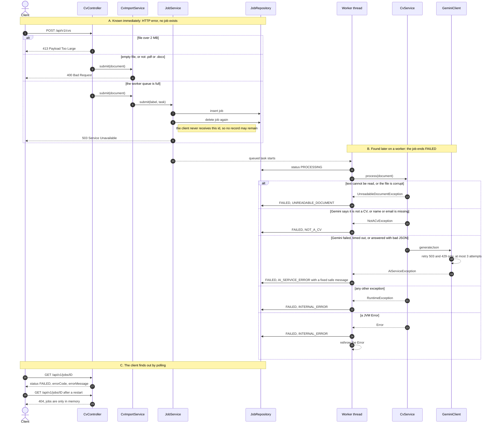

# Sequence: when things go wrong

There are two kinds of failure. Some are known on the request thread and answered at once with an HTTP error. The others happen later on a worker, so the upload was already accepted and the failure is recorded on the job for the client to find by polling.

## How the mapping works

- A failure becomes an error code through the `JobFailure` interface. Exceptions that implement it supply their own `errorCode` and a message that is safe to show. `JobService` has no list of exception types.
- Anything that does not implement it becomes `INTERNAL_ERROR` with the generic message "The job could not be processed", and the details only go to the log.
- Retries apply only to Google's temporary errors (503 and 429). A timeout or any other error fails the job at once, so a stalled call cannot hold a worker thread.
- A malformed id in a path (`/api/v1/jobs/abc`) is a `400` from the mapper before any lookup happens.
